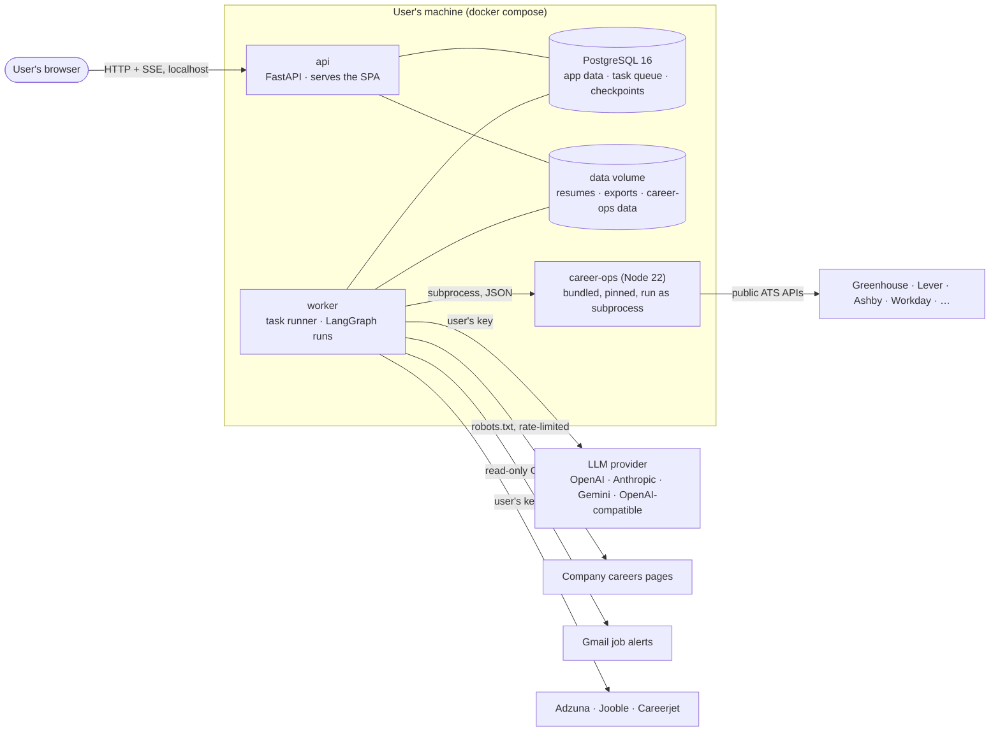
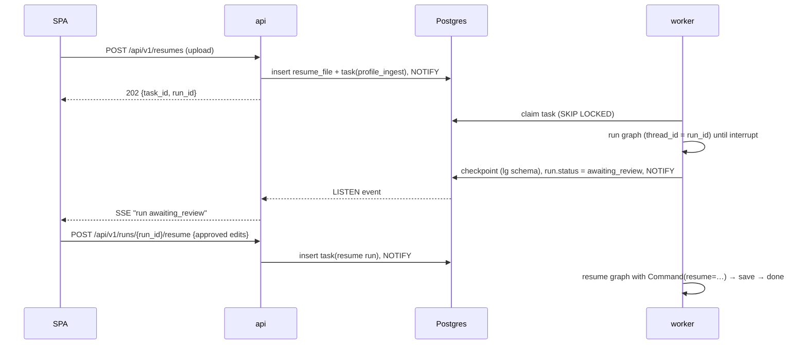
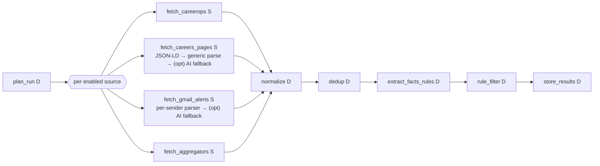

# HireTitan — Architecture

Status: **DRAFT, awaiting Ravi's review** · Date: 2026-11-03 · Branch: `001-setup-and-profile`

This is the system-wide design every feature plan (`specs/NNN-*/plan.md`) builds on. It covers what cuts across features: processes, layers, the AI layer, workflow conventions, the workflow/node catalogue, data ownership and the open technical choices (§12 ADRs). Per-feature details (exact tables, endpoints, prompts, screens) belong in each feature's plan. It must comply with the [constitution](../.specify/memory/constitution.md); where they differ, the constitution wins. Changes after approval go through a PR like any other change.

Input: `docs/clarified-requirements.md` (binding) and `docs/archive/specs-v0/02-design.md` (earlier design, reused where it still fits).

---

## 1. Shape of the system

HireTitan is a **modular monolith**: one Python backend codebase run as two processes (API and worker), one PostgreSQL database, one React single-page app. It runs on the user's machine with `docker compose up`. It is **not** a free-roaming autonomous agent: every AI feature is a **fixed workflow** (a LangGraph graph) of deterministic steps, a few LLM steps with strict output schemas, and explicit pauses for the user's approval.



Nothing in the system can send email, messages or applications (constitution I). The only outbound traffic is: the LLM provider the user configured, the job sources the user enabled, and Gmail read-only.

## 2. Runtime processes and containers

| Process | What it runs | Notes |
|---|---|---|
| `db` | `postgres:16` | Named volume. One database `hiretitan`, schemas `app` (our tables) and `lg` (LangGraph checkpoints). |
| `api` | FastAPI (uvicorn) | REST `/api/v1`, SSE event stream, serves the built SPA as static files. Bound to `127.0.0.1` by default. Never calls an LLM itself; it enqueues tasks. |
| `worker` | Python task runner | Claims tasks from Postgres (`FOR UPDATE SKIP LOCKED`), runs LangGraph workflows, source fetches, career-ops subprocesses, rendering. Runs N concurrent tasks inside one process (asyncio). |
| `web` (dev only) | Vite dev server | In production the SPA is built into the backend image and served by `api`. |

**One backend image** (Python 3.12 + Node 22 + career-ops pinned at v1.38.0) is used for both `api` and `worker` with different commands. A one-shot `migrate` step (Alembic) runs before `api` starts.

Development (Ravi): `db` in Docker; `api`, `worker` and `web` run natively with `uv` and `npm`.

## 3. Backend layers and module layout

```
backend/
  src/hiretitan/
    domain/          pure Python: entities, value objects, state machines, rules (no framework imports)
    application/     use cases + LangGraph workflows; depends on domain and on ports (interfaces)
      ports/         LlmPort, JobSourcePort, FileStoragePort, ClockPort, CareerOpsPort
      workflows/     one module per graph (profile_ingest, search_run, …)
    adapters/        port implementations: llm/{openai,anthropic,gemini,openai_compat}, sources/*, storage/local, careerops/
    infra/           SQLAlchemy models + repositories, Alembic, task queue, settings, secrets, logging
    api/             FastAPI routers, request/response schemas, SSE
    worker/          task runner entrypoint, task handlers
    prompts/         versioned prompt files + output schemas (see §5.4)
  evals/             evaluation sets and runner (per prompt)
  tests/             unit / integration / contract / workflow / architecture
```

Rules (enforced by import-linter, constitution VI):
- `domain` imports nothing from the project's other layers or from frameworks (no FastAPI, SQLAlchemy, LangGraph, pydantic-settings).
- `application` may import `domain` and `application.ports`, plus LangGraph and Pydantic. It does not import `adapters`, `api` or `infra` directly; those are wired in at startup.
- `api` and `worker` are the only composition roots.
- Persistence: SQLAlchemy is used directly in repositories in `infra/`, with no extra repository-interface layer (lean architecture). Application code receives repositories by dependency injection.
- **No-send rule:** an architecture test fails the build if any module imports `smtplib`, an email-sending SDK or a messaging SDK, or if an outbound HTTP adapter uses a non-GET method against a host outside the allowlist (LLM providers, aggregator APIs, Google OAuth).

## 4. Task and workflow execution

Everything that calls an LLM, fetches a source or renders a file runs in the **worker**, never in an API request.



Conventions:
- **Tasks table** (`app.tasks`): type, payload, status (`queued → running → done | failed | dead`), attempts, `run_after`, lease expiry. Retries with backoff, then `dead` (visible in the UI). A crashed worker's lease expires and the task is reclaimed.
- **Workflow runs** (`app.workflow_runs`): one row per graph execution, with the LangGraph `thread_id`, status (`running | awaiting_review | done | failed | cancelled`), and what's waiting for the user. The UI's "Needs your review" list is built from this table.
- **Human approval** uses LangGraph `interrupt()`. Resuming is a new task carrying the user's decision. A paused run costs nothing while it waits.
- **Idempotent nodes:** a node checks for its existing output (keyed by input hash and prompt version) before calling the LLM, so a retried task never pays twice.
- **Progress** goes out as Postgres `NOTIFY` events → `api` → SSE to the browser. No Redis.
- **Manual triggers only** for search runs (requirements §3). The only scheduled job in R1 is the daily `no_response` / follow-up date check, a cheap SQL job.

## 5. AI layer

### 5.1 LLM port

```python
class LlmPort(Protocol):
    async def generate(self, req: LlmRequest[T]) -> LlmResult[T]: ...

@dataclass
class LlmRequest(Generic[T]):
    task: str                 # e.g. "extract_profile"
    prompt: PromptVersion     # name + version + rendered system/user parts
    output_schema: type[T]    # Pydantic model
    tier: Literal["fast", "strong"]
    max_output_tokens: int
    untrusted_blocks: list[UntrustedText]   # already sanitized and delimited (§6)

@dataclass
class LlmResult(Generic[T]):
    value: T | None
    outcome: Literal["ok", "repaired", "fallback", "refused", "budget_blocked", "error"]
    usage: Usage              # tokens in/out, cost_usd, latency_ms
    provider: str
    model: str
```

- One adapter per provider family: **OpenAI**, **Anthropic**, **Google Gemini**, and **OpenAI-compatible** (base URL + key; covers Ollama, OpenRouter, Groq, Azure OpenAI and others). Each adapter uses the provider's own SDK and its native structured-output feature when the model supports it. Otherwise it falls back to JSON in the prompt plus strict parsing (constitution IV, "degrade gracefully").
- **Model tiers**: workflows ask for `fast` or `strong`, never a model name. Settings map each tier to a model per provider. Defaults per provider are chosen in feature 001's plan after measuring cost and quality.
- **Budget guard** (wraps every adapter): estimates the cost before the call and blocks it with `budget_blocked` if the month's spend plus the estimate would pass the cap. Logs every call to `app.llm_calls` (provider, model, task, prompt version, tokens, cost, latency, outcome). Batch actions (e.g. relevance check on 80 jobs) show an estimate before the user confirms.
- Prices come from a versioned price table shipped with the app and editable in settings, since OpenAI-compatible endpoints vary.

### 5.2 Validation chain

Every LLM output passes, in order:
1. **Schema**: parse into the Pydantic model (bounded lengths, enums, required fields).
2. **Business rules** per task, e.g. relevance reason non-empty; queries ≤ N; dates sane.
3. **Truthfulness check** for profile-derived outputs (drafts, tailored resume, answer reviews): every number, employer, date and skill in the output must appear in the cited profile facts (constitution II). This is deterministic code, not another LLM call.
4. **Safety**: no URLs or emails other than allowed ones, no echoed injection phrases.

On failure: **one repair attempt** (the error list goes back to the model), then a **defined fallback** per task (e.g. relevance → "unsure", shown to the user; extraction → partial profile marked for manual entry). A failed AI step never crashes a workflow or loses data.

### 5.3 Model use per node
See §7. Rule of thumb: `fast` for extraction, classification and query proposal; `strong` for drafting and tailoring.

### 5.4 Prompts and evals
- Prompts live as files: `prompts/<task>/v<N>/{system.md, user.md.j2, schema.py, meta.yaml}`. `meta.yaml` holds version, tier, max tokens and changelog.
- Every AI-produced artifact stores `prompt_name`, `prompt_version`, `provider`, `model`.
- `evals/<task>/` holds synthetic cases with expected properties. From v2 of a prompt, the eval run for that task must pass on the configured provider before the new version becomes active. The report goes in the PR (constitution IV and workflow).

## 6. Untrusted-input pipeline (constitution III)

All external text (resumes, job descriptions, careers pages, emails, aggregator results, pasted text) goes through:

1. **Sanitize**: Unicode NFKC normalisation, strip control and zero-width characters, collapse whitespace, cap length.
2. **Screen**: flag injection signals (e.g. "ignore previous instructions", role tags, tool-call syntax). Flags are stored and shown, never silently dropped.
3. **Delimit**: wrapped in clearly marked data blocks with a random boundary token.
4. **Quarantined extraction**: only extraction nodes (`extract_profile`, `extract_job_facts`, `extract_jobs_from_page`, `parse_alert_email`, `split_transcript`) ever see raw untrusted text. They have no tools and a strict, bounded output schema.
5. **Privileged nodes** (relevance, scoring, drafting, tailoring) receive only the **structured, length-bounded facts**, never raw text.

A resume is the user's own file but is still treated as untrusted: it could contain hidden text.

## 7. Workflow catalogue

Legend: **D** deterministic code · **L** LLM node (tier) · **⏸** interrupt for user approval · **S** source/IO.

### W1 `profile_ingest` (feature 001)
Trigger: resume upload (first time or re-upload).

| # | Node | Type | Input → Output |
|---|---|---|---|
| 1 | `store_file` | D | upload → content-addressed file (sha256); type/size checks (PDF/DOCX) |
| 2 | `parse_document` | D | file → plain text + layout hints (sections, bullets) |
| 3 | `sanitize` | D | text → sanitized text + injection flags |
| 4 | `extract_profile` | L fast | sanitized text → `ExtractedProfile` (contact, summary, experience[] with bullets, education, skills, certifications, links) |
| 5 | `validate_profile` | D | schema + rules (dates ordered, no empty roles); repair/fallback |
| 6 | `diff_with_current` | D | only if a confirmed profile exists → field-level diff |
| 7 | `review_profile` | ⏸ | first time: user edits/approves the profile; re-upload: user accepts/rejects each diff item |
| 8 | `save_profile_version` | D | new immutable profile version; becomes the source of truth |

### W2 `query_proposal` (feature 002)
Trigger: user asks for suggestions, or the profile or preferences change.

| # | Node | Type | Input → Output |
|---|---|---|---|
| 1 | `build_context` | D | confirmed profile + preferences (roles, stack, locations weighted highest) |
| 2 | `propose_queries` | L fast | context → `QueryProposal[]` (role keywords, locations, per-source query, rationale) |
| 3 | `validate_queries` | D | bounds, dedup against existing queries |
| 4 | `approve_queries` | ⏸ | user edits/approves/rejects each query |
| 5 | `save_queries` | D | approved queries stored with version |

### W3 `search_run` (features 002 / 002b)
Trigger: user clicks "Run search". **Rules first, AI optional**: the default run makes **no LLM calls**. AI appears only as a fallback for unstructured pages/emails (opt-in per source, cost shown) and in the separate, optional W3b.



| Node | Type | Notes |
|---|---|---|
| `plan_run` | D | approved queries × enabled sources → fetch plan; pushes location/keyword filters into the source request where the board's search supports it |
| `fetch_*` | S | one branch per source (LangGraph `Send`), **isolated**: a failure is recorded on that source's run and doesn't stop the others (constitution VII). career-ops: HireTitan writes its `portals.yml` from the company list and runs `node scan.mjs --json` in its own data folder |
| careers-page parsing | D, then L fast (opt) | 1) schema.org `JobPosting` JSON-LD; 2) generic job-link/title heuristics; 3) only if enabled for that source: `extract_jobs_from_page` (quarantined). robots.txt + rate limit + cache first; failure → "check manually" list |
| alert parsing | D, then L fast (opt) | per-sender template parsers (Naukri, LinkedIn, Indeed, …); `parse_alert_email` (quarantined) only as an opt-in fallback when a template changes |
| `normalize` | D | common `JobPosting` shape (title, company, location(s), url, posted_at, source, description, raw ref) |
| `dedup` | D | exact (canonical URL, ATS requisition ID) → merge; fuzzy (company + title + city) → marked "possible duplicate" for the user to confirm |
| `extract_facts_rules` | D | from title + description: seniority words, years of experience (regex), work mode, locations, stack keywords (matched against the user's stack + a synonym list), pay if stated |
| `rule_filter` | D | the user's rules → **match / maybe / hidden**, each with the deciding rule as the reason; match score = weighted roles + stack + location (from preferences). Only explicit exclusions (blocked cities, excluded title words, max age) hide; nothing is deleted; hidden jobs can be restored |
| `store_results` | D | jobs list (newest first, or by match score), per-source run stats |

No interrupt here: results go straight to the jobs list, where every rule decision is visible and reversible.

### W3b `ai_relevance_check` (feature 002, optional, on demand)
Trigger: the user clicks "Check with AI" on the **maybe** bucket or on selected jobs; the cost estimate is shown first.
`extract_job_facts` L fast (quarantined: raw JD → `JobFacts`, cached per JD hash) → `relevance_check` L fast (facts + profile summary + preferences → `relevant / not_relevant / unsure` + visible reason; batched ~10 jobs per call) → `store_decisions` D (moves jobs between buckets with an "AI:" reason; undoable).

### W4 `score_job` (feature 002, optional, on demand)
`load_facts` D (runs `extract_job_facts` from W3b first if the job has no AI facts yet) → `fit_score` L fast (dimension scores + evidence citing job facts and profile facts) → `apply_caps` D (pure domain rules, e.g. location/pay caps from the user's settings) → `store_score` D.

### W5 `outreach_draft` (feature 004)
Trigger: user picks a job/application and a draft type (referral request, LinkedIn note, HR email, follow-up).

| # | Node | Type | Notes |
|---|---|---|---|
| 1 | `select_facts` | D | relevant profile facts (by overlap with job facts), recipient details entered by the user, style guide |
| 2 | `draft_message` | L strong | → `Draft` (optional subject, body, `cited_fact_ids[]`); length limits per type (LinkedIn note 200/300 chars by account type) |
| 3 | `check_draft` | D | truthfulness + safety + length; repair/fallback |
| 4 | `review_draft` | ⏸ | user edits/approves; the app offers copy buttons and **never sends** |
| 5 | `save_draft` | D | stored with versions; the user can mark it "sent" manually for tracking |

### W6 `tailor_resume` (feature 005)

| # | Node | Type | Notes |
|---|---|---|---|
| 1 | `select_material` | D | confirmed profile + job facts → candidate bullets/skills ranked by overlap |
| 2 | `tailor` | L strong | → `TailoredResume` (summary rewrite; chosen/reordered/rephrased bullets, each with `source_bullet_id`; skills order) |
| 3 | `check_preservation` | D | every number, employer, date, title and skill traces to a source bullet/fact; no new facts |
| 4 | `review_resume` | ⏸ | full-document preview with inline edits |
| 5 | `render` | D | one resume document model → PDF (HTML template + WeasyPrint) and DOCX (python-docx); ATS-friendly single column |
| 6 | `save_version` | D | stored and linked to the application |

### W9 `content_suggestions` (feature 005, optional, on button press)
Trigger: the user asks for suggestions on the **base profile** (general) or on a **tailored resume** (job-aware). The cost estimate is shown first. Never runs automatically.

| # | Node | Type | Notes |
|---|---|---|---|
| 1 | `build_review_context` | D | resume content (profile or tailored version) + job facts if job-aware |
| 2 | `suggest_improvements` | L strong | → `Suggestion[]`: target (bullet/summary/skill/section order), kind (`rewrite`, `reorder`, `add_keyword`, `clarify_impact`, `remove_weak`, `ask_user`), proposed text, reason (e.g. "JD asks for Kafka; you list it but no bullet shows it") |
| 3 | `check_suggestions` | D | the truthfulness check applies to every proposed text; anything that would need a new fact is converted into an `ask_user` question ("What was the latency improvement here?") instead of a claim |
| 4 | `review_suggestions` | ⏸ | the user accepts / edits / rejects each one; answers `ask_user` questions |
| 5 | `apply_accepted` | D | accepted changes → new profile version (base) or new tailored version (job-aware); user answers become confirmed profile facts |

Same single template; suggestions change content, never layout.

### W7 `interview_review` (feature 006, R2, sketch)
`split_transcript` L fast (quarantined: pasted notes → Q&A pairs) → ⏸ confirm split → on button press per answer: `review_answer` L strong (cites profile facts) → `weak_topics` D (aggregation) → `prep_plan` L fast.

### W8 `company_discovery` (feature 002, user-added companies)
`discover_board` S (career-ops `discover-ats.mjs`) → ⏸ user confirms the matched board (or none → careers-page fallback) → `save_company` D.

## 8. Data ownership (overview)

Exact schemas are designed per feature. Ownership by area:

| Area | Main tables (indicative) | Owner feature |
|---|---|---|
| Setup | `settings`, `provider_configs` (encrypted keys), `budget` | 001 |
| Profile | `resume_files`, `profiles`, `profile_versions`, `preferences`, `style_guides` | 001 (style guide: 004) |
| Runtime | `tasks`, `workflow_runs`, `llm_calls`, `events` | 001 (foundation) |
| Search | `companies` (built-in seed + user), `sources`, `search_queries`, `source_runs`, `jobs`, `job_sources`, `job_facts`, `relevance_decisions`, `job_scores` | 002 |
| Applications | `applications`, `application_events`, `contacts` (entered by the user), `offers` | 003 |
| Outreach | `drafts`, `draft_versions` | 004 |
| Resumes | `tailored_resumes` | 005 |
| Interviews | `interview_sessions`, `qa_items`, `answer_reviews` | 006 |

Cross-cutting rules: UUID primary keys; `created_at`/`updated_at`; AI-produced rows carry prompt version and model; user data can be deleted per item and entirely (constitution VIII).

**Companies table.** `app.companies` is the runtime source of truth for the company list: name, city, website, careers URL, ATS vendor + board id, resolution status (`verified` / `user_confirmed` / `unresolved` / `check_manually`), origin (`built_in` / `user`), `user_modified`, `hidden`, `seed_version`, last checked. The repo ships the maintainer-verified list as seed data (`backend/seed/companies.yaml`, company columns only, never contacts). A seed loader inserts it on install and, on later releases, **upserts by a stable key** without touching rows the user modified or deleted. Users add, edit, hide and delete companies in the app; **CSV import/export** lets the list be maintained in a spreadsheet and loaded back (import = preview + confirm, same upsert rules).

**Files**: `FileStoragePort` → local volume `data/files/<sha256[:2]>/<sha256>`; content-addressed, deduplicated, deleted when no row references them.

## 9. Security and privacy

- **Local only** (Ravi, 2026-11-03: "we are not gonna host it anywhere. anyone wanna use should pull the repo and run locally"). `api` binds to `127.0.0.1` and there is no login. There's no hosted version and no network-exposure setting in R1; docker compose publishes ports on `127.0.0.1` only.
- API keys are stored **encrypted at rest** (Fernet). The key lives in `data/secret.key`, is generated on first run and is never logged. Keys are never sent back to the browser after entry (masked).
- No telemetry. Logs are structured JSON with secrets and resume text redacted.
- Careers-page fetching: honest User-Agent (`HireTitan/<version> (+repo URL)`), robots.txt, per-host rate limit, cache, timeouts, size caps. HTML is parsed, never executed.
- Uploads: type sniffing (not just the extension), size limit, parsed in the worker.
- SPA: strict Content Security Policy; model output is rendered as text, never as HTML.

## 10. Frontend

React 18 + Vite + TypeScript strict. React Router; **TanStack Query** for server state; **Tailwind + shadcn/ui** components; react-hook-form + zod for forms; a TypeScript API client generated from FastAPI's OpenAPI schema (`openapi-typescript`), so types match the backend; EventSource for SSE. Tests: Vitest + Testing Library; Playwright end-to-end for the main journeys.

Main screens (R1): Setup wizard · Profile (view/edit, re-upload diff) · Preferences · Queries · Jobs (list, filters, hidden-with-reason, job detail) · Applications · Drafts · Tailored resumes · Needs your review (paused runs) · Settings (provider, budget, sources) · Usage (AI spend).

## 11. Testing strategy (constitution V)

| Level | What | Tools |
|---|---|---|
| Unit | domain rules, state machines, validators, truthfulness checker, dedup, sanitizer | pytest |
| Integration | repositories, migrations, task queue (SKIP LOCKED, leases), checkpointer | pytest + **Testcontainers PostgreSQL 16** |
| Contract | each source adapter and LLM adapter against recorded fixtures | pytest + respx / recorded JSON |
| Workflow | each graph end to end with a **fake LLM** (scripted outputs, including invalid ones to exercise repair/fallback) and interrupt/resume | pytest + LangGraph |
| API | routers via `httpx.AsyncClient` against real Postgres | pytest |
| Architecture | import-linter contracts, the no-send test | import-linter + pytest |
| Frontend | components and hooks; e2e journeys against a seeded backend with the fake LLM | Vitest, Playwright |
| Evals | prompt quality against real providers; run manually and in PRs that change prompts | `evals/` runner |

Test names reference requirement/scenario IDs. Coverage gates: ≥ 90% domain + application, ≥ 80% overall.

## 12. Architecture decisions (ADRs)

Each ADR: decision · why · alternatives. All are **proposed** until Ravi approves this document.

**ADR-01 Modular monolith, two processes.** One codebase, `api` + `worker`, one Postgres. *Why:* the simplest design that keeps LLM calls and fetches out of request handlers, with an easy `docker compose up`. *Alt:* microservices (overkill for one user); a single process (long runs would block or die with HTTP requests).

**ADR-02 Own thin LLM adapters, not LiteLLM.** Four adapters behind `LlmPort` using the official SDKs (`openai`, `anthropic`, `google-genai`). *Why:* we need provider-specific structured output, refusal handling and accurate usage/cost data, and our validation, budget and logging layer sits on top anyway. Four adapters are small and well-testable, bring fewer heavy transitive dependencies, and show real design work. *Alt:* LiteLLM (100+ providers for free, but a large dependency whose structured-output behaviour varies by provider; our layer would wrap it anyway). Revisit if users ask for many more native providers; the OpenAI-compatible adapter already covers most. **Decided (Ravi, 2026-11-03): OpenAI first.** Feature 001 builds only the OpenAI adapter, and development and evals use Ravi's OpenAI key. The Anthropic, Gemini and OpenAI-compatible adapters are separate tasks that must land before the first public release (constitution IV unchanged). The port, fake LLM and contract tests are provider-neutral from day one.

**ADR-03 Postgres as the task queue.** `tasks` table + `SELECT … FOR UPDATE SKIP LOCKED` + `LISTEN/NOTIFY`. *Why:* no extra service (Redis/RabbitMQ), transactional with app data, plenty for one user. *Alt:* Celery/RQ + Redis (another container to run).

**ADR-04 LangGraph with the Postgres checkpointer.** `langgraph-checkpoint-postgres` in schema `lg` of the same database; `thread_id` = `workflow_runs.id`; human approval via `interrupt()` / `Command(resume=…)`. *Why:* durable pause/resume for approvals and crash recovery, without writing our own state machine for every workflow. *Alt:* plain async functions + our own state tables (one less dependency, but we would rebuild interrupts and checkpointing).

**ADR-05 career-ops as a pinned subprocess.** Node 22 + career-ops v1.38.0 baked into the backend image with `PLAYWRIGHT_SKIP_BROWSER_DOWNLOAD=1`. The scanner uses plain HTTP (checked: `scan.mjs` doesn't import Playwright); browser-based scripts aren't used. HireTitan owns a separate career-ops data folder, generates its `portals.yml` from the company list and approved queries, and reads `scan.mjs --json` output through `CareerOpsPort`. *Why:* reuses mature ATS providers (Greenhouse, Lever, Ashby, Workday, …) instead of rewriting them; a pinned version keeps contract tests stable. *Alt:* port the providers to Python (lots of work, loses upstream fixes); call the user's own career-ops install (breaks "anyone can clone it").

**ADR-06 Resume parsing: pypdf / pdfplumber + python-docx.** Permissive licences, pure Python. PyMuPDF is excluded: it's AGPL, which conflicts with shipping under MIT. Scanned (image-only) PDFs get no OCR in R1; the user is told and can paste the text or edit the profile by hand.

**ADR-07 Resume rendering: one document model → WeasyPrint (PDF) and python-docx (DOCX).** An HTML/CSS template (Jinja2) for the PDF, so the browser preview matches the PDF; the DOCX is built from the same model. **Exactly one ATS-friendly single-column template** (decided by Ravi); improvement happens through content (W6 tailoring, W9 suggestions), not layout. *Alt:* career-ops `generate-pdf.mjs` (needs Playwright + Chromium in the image, about 300 MB); LaTeX (heavy, poor DOCX story).

**ADR-08 Realtime via SSE over LISTEN/NOTIFY.** One-way server → browser updates (run progress, "needs review"). *Alt:* WebSockets (two-way isn't needed); polling (kept as a fallback only).

**ADR-09 Secrets encrypted in the database.** Fernet, with a generated key file in the data volume; env vars can override for advanced users. *Why:* the setup wizard must be able to save keys, and plain-text storage would be careless. *Alt:* OS keychain (not portable inside Docker).

**ADR-10 Frontend stack.** React + Vite + TS, TanStack Query, React Router, Tailwind + shadcn/ui, generated OpenAPI client. *Why:* common, well documented, fast to build, typed end to end.

**ADR-11 Default models per provider (deferred).** Decided in feature 001's plan, after a small eval on synthetic resumes that measures extraction quality and cost per provider for the `fast` and `strong` tiers.

## 13. Open questions for Ravi

1. ~~ADR-02~~ decided: own adapters, OpenAI first; the other providers before the public release.
2. ~~ADR-07 templates~~ decided: one template; optional content suggestions (W9).
3. ~~Network exposure~~ decided: local only, no hosting, no login.
4. Anything in the workflow catalogue (§7) you'd add, drop or reorder, especially which steps should pause for your approval?
5. ~~Company list storage~~ decided: Postgres `companies` table seeded from the repo, editable in the app, CSV import/export (§8).
