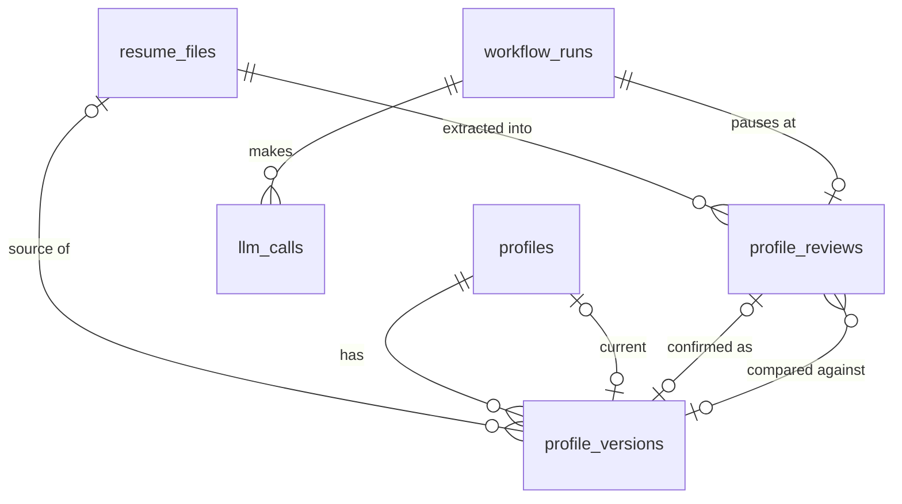

# Data Model: Setup and Profile (first slice)

**Feature**: [spec.md](spec.md) · **Plan**: [plan.md](plan.md) · **Date**: 2026-11-03

PostgreSQL 16, database `hiretitan`, schema `app` (our tables), schema `lg` (LangGraph checkpoints, managed by `langgraph-checkpoint-postgres`) and Procrastinate's own tables. Conventions (architecture §8): UUID primary keys (`uuid7` generated in the app), `created_at` / `updated_at` as `timestamptz` UTC, and every AI-produced row carries `prompt_name`, `prompt_version`, `provider` and `model`.

Ownership: the **profile** module owns `resume_files`, `profile_reviews`, `profiles` and `profile_versions`; **preferences** owns `preferences`; **setup** owns `settings` and data deletion; **platform/runtime** owns `workflow_runs`; **platform/llm** owns `llm_calls` and `provider_status` (platform never imports feature modules, so the budget guard gets the cap through an injected provider).

---

## Tables

### `app.resume_files` (profile)

| Column | Type | Rules |
|---|---|---|
| id | uuid PK | |
| kind | text | `upload_pdf` · `upload_docx` · `pasted_text` |
| original_name | text | ≤ 255 chars; `pasted text` for pasted input |
| size_bytes | int | 1 … 10 485 760 (FR-001) |
| sha256 | char(64) | content hash; storage key `files/<sha[:2]>/<sha>` |
| page_count | int null | PDF only; ≤ 20 |
| parse_status | text | `pending` · `parsed` · `no_text` · `failed` |
| parse_result | jsonb null | see `ParseResult` below |
| created_at | timestamptz | upload time |

`ParseResult` = `{ visible_text_chars, truncated_at: int|null, hidden_text: [{page, text}], injection_flags: [{rule_id, severity, excerpt, location: visible|hidden}] }`. The sanitized text itself is stored in the storage volume next to the file (`<sha>.txt`), never in logs.

### `app.workflow_runs` (platform/runtime)

| Column | Type | Rules |
|---|---|---|
| id | uuid PK | also the LangGraph `thread_id` |
| workflow | text | `profile_ingest` (this slice) |
| subject_id | uuid null | e.g. `resume_files.id` |
| status | text | `queued` · `running` · `awaiting_review` · `paused` · `done` · `failed` · `cancelled` |
| pause_reason | text null | `key_missing` · `key_rejected` · `budget_reached`; required iff `status = paused` |
| waiting_for | text null | `profile_review` · `injection_decision`; required iff `status = awaiting_review` |
| current_step | text null | node name, for progress |
| error | text null | user-facing message when `failed` |
| created_at / updated_at | timestamptz | |

**State transitions**

```
queued → running
running → awaiting_review | paused | done | failed | cancelled
awaiting_review → queued (user decision) | cancelled (discarded / file deleted)
paused → queued (reason cleared: key working / budget raised) | cancelled
failed → queued ("Try again")
```

`done`, `cancelled` are final. Enforced by a pure domain state machine (`platform/runtime/domain/run_state.py`) with unit tests per transition.

### `app.profile_reviews` (profile)

| Column | Type | Rules |
|---|---|---|
| id | uuid PK | |
| run_id | uuid FK → workflow_runs | unique |
| resume_file_id | uuid FK → resume_files null | ON DELETE CASCADE (deleting the file removes its review, FR-034) |
| status | text | `open` · `confirmed` · `discarded` |
| extraction | jsonb | validated `ExtractedProfile` merged with masked-out contact values |
| dropped_items | jsonb | `[{path, value, reason}]` (FR-011) |
| flags | jsonb | copy of hidden text and injection flags for display |
| compare_to_version_id | uuid FK → profile_versions null | set on re-upload (FR-014) |
| changed_paths | jsonb | list of field paths that differ from `compare_to_version_id` |
| draft | jsonb null | user's unsaved edits (FR-016); `ProfileContent` shape |
| draft_saved_at | timestamptz null | |
| prompt_name / prompt_version / provider / model | text | provenance (FR-012); `"none"` for a manual review |
| created_at / updated_at | timestamptz | |

Constraint: partial unique index `ON (status) WHERE status = 'open'`, so at most one open review exists. A manual review (US5 "Type it in myself", or manual entry after an injection warning) is marked by `flags.extraction_outcome = "manual"`, and has `resume_file_id` null when no file was involved. Confirming it creates a version with `created_by = manual` (or `manual_edit` when a current version exists) and no provenance.

### `app.profiles` (profile)

| Column | Type | Rules |
|---|---|---|
| id | uuid PK | exactly one row (single user); `CHECK` via singleton key column `singleton boolean DEFAULT true UNIQUE` |
| current_version_id | uuid FK → profile_versions null | null until first confirm |
| created_at / updated_at | timestamptz | |

### `app.profile_versions` (profile)

| Column | Type | Rules |
|---|---|---|
| id | uuid PK | |
| profile_id | uuid FK → profiles | |
| number | int | 1, 2, 3 … per profile (unique with profile_id) |
| content | jsonb | `ProfileContent` (below); **immutable**: no UPDATE allowed (trigger raises) |
| created_by | text | `extraction` · `manual` · `manual_edit` |
| source_file_id | uuid FK → resume_files null | ON DELETE SET NULL |
| source_deleted | bool | true after the source file is deleted (FR-034) |
| review_id | uuid FK → profile_reviews null | when created from a review; ON DELETE SET NULL (the review is removed with its file) |
| prompt_name / prompt_version / provider / model | text null | copied from the review when `created_by = extraction`, so provenance survives file deletion (constitution IV); null for manual versions |
| created_at | timestamptz | |

The immutability trigger allows only the deletion bookkeeping: `source_file_id → NULL`, `review_id → NULL`, `source_deleted → true`. `content` can never change.

### `app.preferences` (preferences)

Single row (`singleton` key). Columns map 1:1 to `Preferences` below; `content jsonb` + `saved_at timestamptz null` (null = never saved, defaults shown). Stored as validated JSON because this slice reads it whole; feature 002 may normalise it.

### `app.settings` (setup)

Single row: `budget_cap_usd numeric(8,2) DEFAULT 25.00 CHECK (budget_cap_usd >= 0)`, `display_name text null CHECK (char_length(display_name) BETWEEN 1 AND 120)` (setup step 1, FR-039), `setup_completed_at timestamptz null` (FR-040; migration `0009` sets it for installs that already have a confirmed profile and saved preferences), `updated_at`. Tier → model mapping is **not** stored in this slice (fixed in `models.yaml`, clarification Q2).

### `app.provider_status` (platform/llm)

| Column | Type | Rules |
|---|---|---|
| provider | text PK | `openai` |
| status | text | `unknown` · `working` · `missing` · `rejected` · `unreachable` |
| message | text null | user-facing detail, never contains the key |
| checked_at | timestamptz null | |

### `app.llm_calls` (platform/llm)

| Column | Type | Rules |
|---|---|---|
| id | uuid PK | |
| run_id | uuid FK → workflow_runs null | |
| task | text | e.g. `extract_profile` |
| prompt_name / prompt_version | text | |
| provider / model | text | |
| input_tokens / cached_input_tokens / output_tokens | int | 0 when blocked |
| cost_usd | numeric(10,6) | 0 when blocked |
| estimated_cost_usd | numeric(10,6) | pre-call estimate |
| latency_ms | int | |
| outcome | text | `ok` · `repaired` · `fallback` · `refused` · `budget_blocked` · `key_rejected` · `error` |
| created_at | timestamptz | index for monthly spend |

Never stores prompt or response text (privacy); the validated output lives in the owning row.

---

## Value shapes (frozen dataclasses in `domain`; Pydantic models at the api and LLM edges map to them)

### `ProfileContent` (confirmed profile, review draft)

```
contact:        { name: str (1–120, required to confirm), email: str|null, phone: str|null,
                  location: str|null (≤120), links: [{label: str|null, url: str}] (≤10) }
headline:       str|null (≤200)
summary:        str|null (≤2000)
experience:     [ { id, employer (1–200), title (1–200), location|null, start: YearMonth,
                    end: YearMonth|null, current: bool, bullets: [str ≤ 500] (≤ 30) } ] (≤ 40)
education:      [ { id, institution (1–200), qualification|null, field|null,
                    start: YearMonth|null, end: YearMonth|null, grade|null (≤ 50) } ] (≤ 20)
skills:         [ str (1–80) ] (≤ 150), unique case/space-insensitively, original wording kept
projects:       [ { id, name (1–200), description|null (≤1000), technologies: [str] (≤30), link|null } ] (≤ 30)
certifications: [ { id, name (1–200), issuer|null, date: YearMonth|null } ] (≤ 30)
```

`YearMonth` = `{year: 1950–2100, month: 1–12 | null}`. Item `id`s are stable UUIDs so later features can cite facts (constitution II).

**Confirm rules (FR-018, pure domain `profile/domain/rules.py`)**: `contact.name` non-empty; at least one of experience / education / skills non-empty; for every entry with both dates, `end ≥ start`; `current = true` ⇒ `end = null`; experience entries need employer and title.

### `ExtractedProfile` (AI output schema, prompt `extract_profile` v1)

Same as `ProfileContent` **minus** `contact.email`, `contact.phone`, `contact.links` and item `id`s (FR-008a: the model never sees or returns them). All strings length-bounded, all lists capped as above; `additionalProperties: false`. Ids are assigned after validation.

### `Preferences` (FR-023, defaults FR-024)

| Field | Type | Default | Validation |
|---|---|---|---|
| target_roles | [str 1–100] (≤ 20) | `[]` | ≥ 1 to save |
| seniority_levels | [enum] | `[]` | enum: intern, entry, junior, mid, senior, lead, staff, principal, manager, director |
| years_experience | decimal 0–60, step 0.5, null | null | ≥ 0; typed by the user only (clarification Q3) |
| key_skills | [str 1–80] (≤ 50) | `[]` | case-insensitive unique |
| preferred_locations | [{city: str\|null, country: ISO-3166 alpha-2}] (≤ 20) | `[]` | |
| default_country | ISO-3166 alpha-2 | `IN` | used for phone parsing and location defaults |
| work_modes | set of `onsite`·`hybrid`·`remote` | all three | ≥ 1 |
| willing_to_relocate | bool | false | |
| blocked_locations | [{city, country}] (≤ 50) | `[]` | |
| job_types | set of `full_time`·`contract`·`internship` | `{full_time}` | ≥ 1 |
| pay.currency | ISO-4217 | `INR` | |
| pay.min_annual | decimal ≥ 0, null | null | stored as annual amount in currency units |
| pay.target_annual | decimal ≥ 0, null | null | `min ≤ target` when both set |
| pay.basis | `fixed`·`total` | `fixed` | |
| notice_period_days | int 0–365, null | 30 | XOR with earliest_start_date |
| earliest_start_date | date null | null | |
| preferred_companies | [str 1–200] (≤ 100) | `[]` | |
| avoided_companies | [str 1–200] (≤ 100) | `[]` | |

Display rule (US2-AS5): when `pay.currency = INR`, the UI shows and accepts pay in LPA (`annual / 100 000`); other currencies use the annual amount. Defaults live in `preferences/domain/defaults.py` and are documented in the user guide; nothing person-specific.

---

## Relationships


